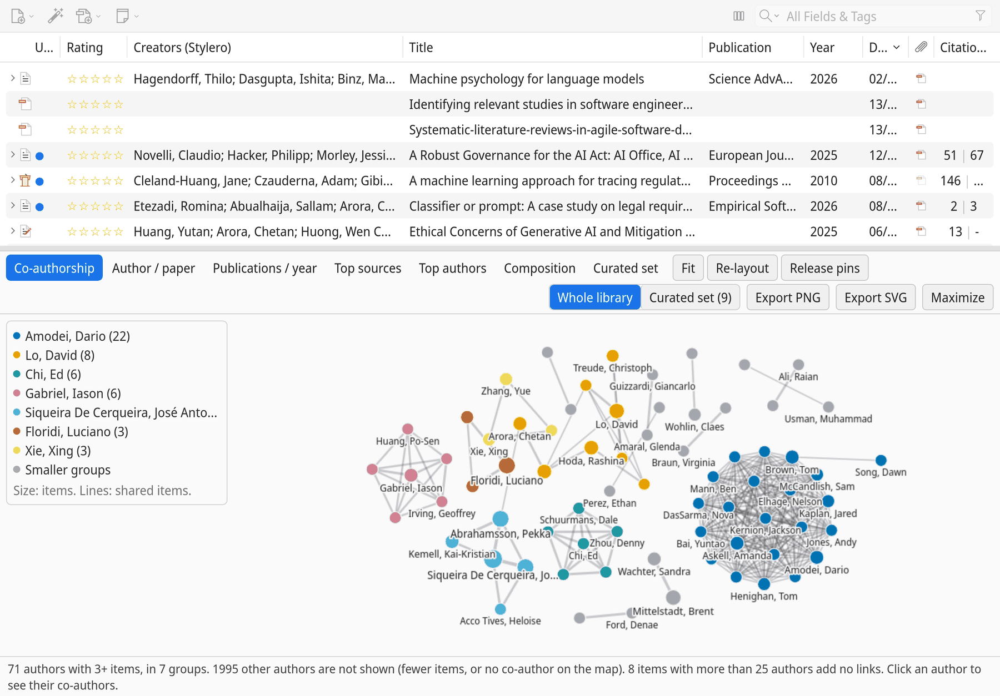
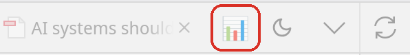
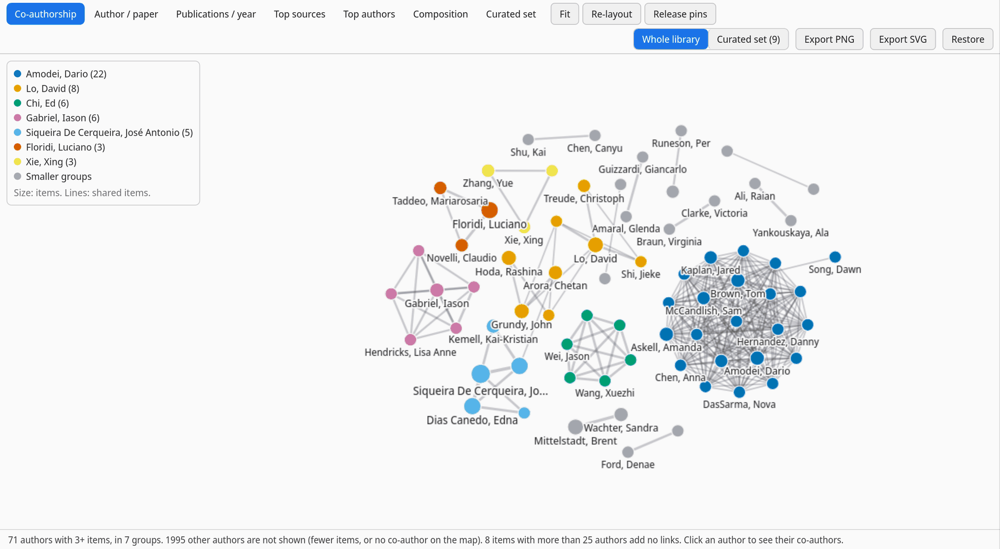
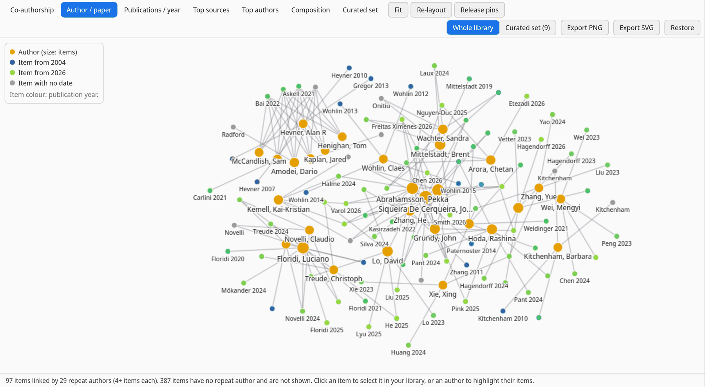
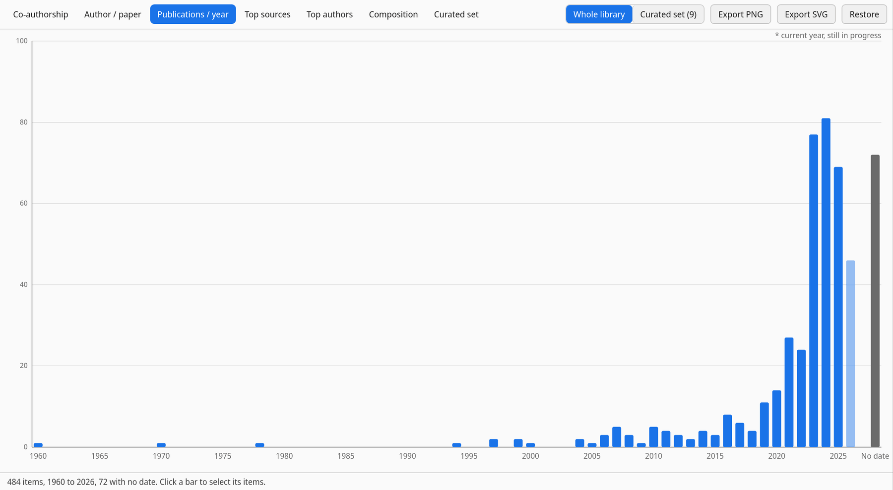
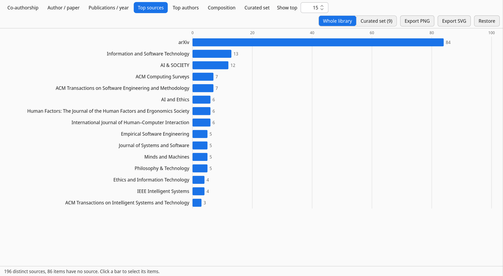
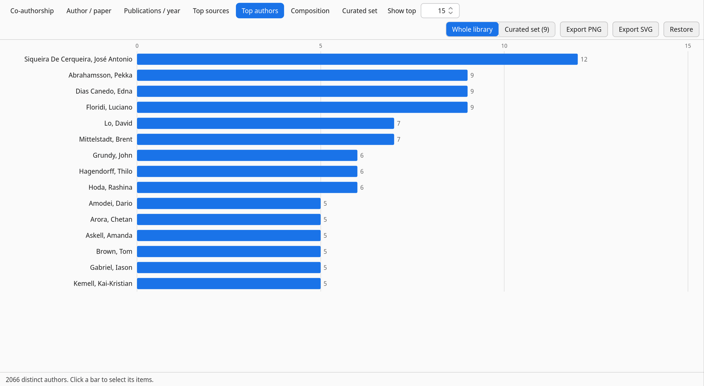
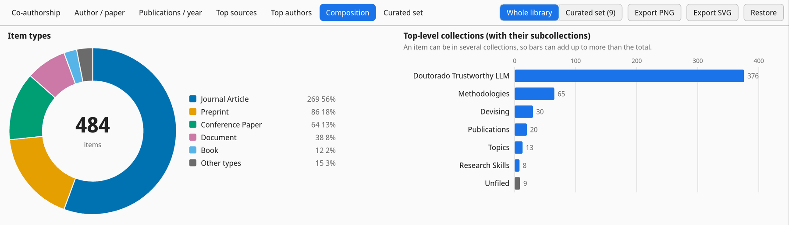
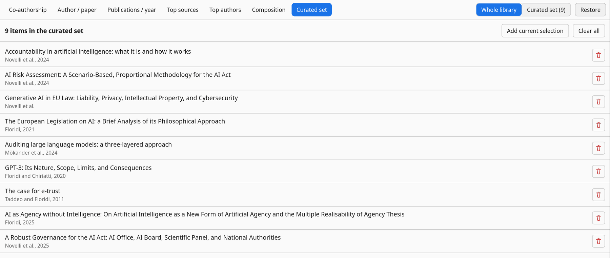

# Zotero Bibliometero

[](https://github.com/josesiqueira/zotero-bibliometero/releases/latest)
[](https://github.com/josesiqueira/zotero-bibliometero/releases)
[](LICENSE)
[](https://github.com/josesiqueira/zotero-bibliometero/issues)
[](https://josesiqueira.github.io/zotero-bibliometero/)

**See your Zotero library as networks and charts.**

<!-- docs:hero:start (generated by npm run docs, edit the source named in CONTRIBUTING.md) -->
<picture>
  <source media="(prefers-color-scheme: dark)" srcset="docs/images/hero-dark.png">
  
</picture>

<sub>The Insights panel under the item list, showing the research groups in a library of about 500 items.</sub>
<!-- docs:hero:end -->

<!-- docs:intro:start (generated by npm run docs, edit the source named in CONTRIBUTING.md) -->
Zotero Bibliometero adds an Insights panel to Zotero that turns your library into networks and charts. It shows which research groups recur in your reading, which journals and conferences hold your field, and how your library spreads over time. Click any bar, slice or author and Zotero selects exactly those items. Everything runs inside Zotero, with no account and no data leaving your computer.
<!-- docs:intro:end -->

## Get started

<!-- docs:install:start (generated by npm run docs, edit the source named in CONTRIBUTING.md) -->
1. Download zotero-bibliometero.xpi from [the latest release](https://github.com/josesiqueira/zotero-bibliometero/releases/latest).
2. In Zotero, open Tools, Plugins.
3. Click the gear icon, choose Install Plugin From File, and pick the downloaded file.
4. Click the chart button at the right end of the tab bar. The Insights panel opens under your item list.

   <picture>
     <source media="(prefers-color-scheme: dark)" srcset="docs/images/button-dark.png">
     
   </picture>

5. Pick a view from the strip at the top of the panel.
6. Click a bar or a slice to select those items in your library. On the network maps, click an author to see their co-authors and double-click to select their items.

Installed copies update themselves when a new version is released.

Full guide: <https://josesiqueira.github.io/zotero-bibliometero/>
<!-- docs:install:end -->

## What you can find out

<!-- docs:views:start (generated by npm run docs, edit the source named in CONTRIBUTING.md) -->
| View | The question it answers |
|---|---|
| [Co-authorship](#co-authorship) | Which research groups keep coming up in my reading? |
| [Author / paper](#author--paper) | Which of my items come from the same people? |
| [Publications / year](#publications--year) | How recent is the literature I collected? |
| [Top sources](#top-sources) | Where is my field published? |
| [Top authors](#top-authors) | Whose work do I collect most? |
| [Composition](#composition) | What kinds of items do I have, and where are they filed? |
| [Curated set](#curated-set) | How do I look at just the items for one project? |

### Co-authorship

**Which research groups keep coming up in my reading?** The research groups in your reading: authors who appear on several of your items, linked when they wrote together, coloured by group.

<picture>
  <source media="(prefers-color-scheme: dark)" srcset="docs/images/coauthorship-dark.png">
  
</picture>

<details>
<summary>How to read it</summary>

- Shows authors with at least 2 items (raised automatically, for example to 3+, so the map stays readable). Authors with a single item, or no co-author on the map, are left out; Top authors still counts them.
- Groups are found with the Louvain method, as in VOSviewer and bibliometrix, and named after their member with the most items. The legend lists them.
- Node size shows items, line width shows shared items. Labels are drawn biggest first and skipped where they would overlap.
- Click an author to highlight their co-authors and list them in the status line; double-click to select their items in your library.
- Items with more than 25 authors count toward each author but add no links, so large consortium papers do not swamp the map.
- Drag a node to pin it, pan the map, zoom with the mouse wheel. Fit, Re-layout and Release pins are in the header.

</details>

### Author / paper

**Which of my items come from the same people?** Which of your items come from the same people: authors who appear on several items, joined to those items.

<picture>
  <source media="(prefers-color-scheme: dark)" srcset="docs/images/author-paper-dark.png">
  
</picture>

<details>
<summary>How to read it</summary>

- Shows repeat authors (2+ items, raised automatically on big libraries) and the items they wrote; items without a repeat author are left out and counted in the status line.
- Items are labelled by first author and year and coloured by publication year; the full title is in the tooltip.
- Click an item to select it in your library, double-click to open it. Click an author to highlight their items, double-click to select them.
- On a curated set every author is shown, so you can see exactly who connects the items you picked.

</details>

### Publications / year

**How recent is the literature I collected?** Your items per publication year, with every year in the range shown and a separate bar for items with no date.

<picture>
  <source media="(prefers-color-scheme: dark)" srcset="docs/images/pubs-per-year-dark.png">
  
</picture>

<details>
<summary>How to read it</summary>

- The current year is drawn lighter and marked as still in progress, so a short bar is not read as a decline.
- Hover a bar for the count; click it to select exactly those items in your library.

</details>

### Top sources

**Where is my field published?** A ranked bar chart of the journals, conference proceedings, book series and repositories that hold the most of your items.

<picture>
  <source media="(prefers-color-scheme: dark)" srcset="docs/images/top-sources-dark.png">
  
</picture>

<details>
<summary>How to read it</summary>

- A book's publisher, a thesis' university or a report's institution is not a source; those items count as having no source unless they belong to a series.
- Spelling variants (case, accents, punctuation, & and "and") are counted as one source.
- Choose how many to show with the Show top box; click a bar to select exactly those items.

</details>

### Top authors

**Whose work do I collect most?** A ranked bar chart of authors by the number of your items they wrote.

<picture>
  <source media="(prefers-color-scheme: dark)" srcset="docs/images/top-authors-dark.png">
  
</picture>

<details>
<summary>How to read it</summary>

- Counts authors only (the item type's main creator role); editors are used only for items with no authors.
- Name variants are joined: accents and case are ignored, and an initials-only form (Floridi, L.) joins the full name (Floridi, Luciano) when only one person matches. Different full names that share an initial stay apart.
- Choose how many to show with the Show top box; click a bar to select exactly those items.

</details>

### Composition

**What kinds of items do I have, and where are they filed?** A donut of your items by item type, and bars for your top-level collections (subcollections included).

<picture>
  <source media="(prefers-color-scheme: dark)" srcset="docs/images/composition-dark.png">
  
</picture>

<details>
<summary>How to read it</summary>

- Item types beyond the six largest are grouped as Other types.
- Collections are bars, not slices, because an item can be in several collections. Unfiled shows items in no collection.
- Click a slice to select those items; click a collection bar to open the collection.

</details>

### Curated set

**How do I look at just the items for one project?** The items in your curated set, a hand-picked group that every view can focus on.

<picture>
  <source media="(prefers-color-scheme: dark)" srcset="docs/images/set-dark.png">
  
</picture>

<details>
<summary>How to read it</summary>

- Each row shows the title, first author and year. Double-click a row to select the item in your library.
- Remove one item with its trash button, or empty the set with Clear all (it asks first).
- Add current selection adds the items selected in the item list.

</details>
<!-- docs:views:end -->

## Working in the panel

<!-- docs:panel:start (generated by npm run docs, edit the source named in CONTRIBUTING.md) -->
- **Opens under your item list.** The chart button in the tab bar opens Insights as a panel below the item list, so your library stays in view. Drag the divider (or focus it and use the arrow keys) to resize it; Zotero remembers the height.
- **Maximize to a full tab.** Maximize moves Insights into its own Zotero tab for a bigger map. Restore puts it back under the list, on the same view.
- **Whole library or a curated set.** The switch in the header picks what the views show: the whole library you have selected on the left (My Library or a group), or a curated set of items you pick. The set is kept per library and does not touch your tags or collections.
- **Every number leads to its items.** Click a bar, a slice or an author and Insights selects exactly those items in the item list, and says so in the status line. A bar that says 12 selects 12 items.
- **Says what you are looking at.** The status line under each view explains it in one sentence: what is counted, what was left out and why, and what a click does. Network maps also show a legend.
- **Figures ready for a paper.** Export PNG and Export SVG save the current view as a figure on a white background, with a title, legend and a caption naming the library and date, at 2400 by 1440 pixels for the PNG.
- **Stays up to date.** Add, edit, trash or delete items, change the curated set, or select another library, and the open view refreshes on its own. Light and dark follow Zotero unless you pick one in Settings.
<!-- docs:panel:end -->

## Right-click commands

<!-- docs:commands:start (generated by npm run docs, edit the source named in CONTRIBUTING.md) -->
| Where | Command | What it does |
|---|---|---|
| Right-click one or more items | Add to Insights curated set | Adds the selected items to the curated set. When all of them are already in the set, the command reads Remove from Insights curated set instead. |
| Right-click one or more items | Remove from Insights curated set | Removes the selected items from the curated set. |
| Right-click a collection | Add collection to Insights curated set | Adds the items in the collection to the curated set. Items that are only in its subcollections are not added. |
<!-- docs:commands:end -->

## Settings

<!-- docs:settings:start (generated by npm run docs, edit the source named in CONTRIBUTING.md) -->
Open Zotero Settings, Bibliometero.

| Setting | Choices | Default | What it does |
|---|---|---|---|
| Default view | Co-authorship, Author / paper, Publications / year, Top sources, Top authors, Composition | Co-authorship | The view Insights opens on. |
| Theme | auto, light, dark | auto | auto follows Zotero; light and dark force one look. Exported figures are always light. |
| Source | Whole library, Curated set | Whole library | Whole library or Curated set. Same as the switch in the panel header. |
| Top-N (ranked charts) | a number from 1 to 100 | 15 | How many bars Top sources and Top authors show. The Show top box in each chart's header overrides it for that chart. |
<!-- docs:settings:end -->

## What changed

See [CHANGELOG.md](CHANGELOG.md).

## Development

```bash
npm install
npm start          # live-reload dev against a running Zotero
npm run build      # build + typecheck -> .scaffold/build/zotero-bibliometero.xpi
npx tsc --noEmit   # typecheck only
npm run test:unit  # data-layer unit tests (Node, no Zotero needed)
npm run docs       # regenerate the README sections and the website (_site/)
npm run docs:check # fail if the docs disagree with the code (CI runs this)
```

The README sections above, the [website](https://josesiqueira.github.io/zotero-bibliometero/)
and the in-app view tooltips are all generated from the same source files. See
[CONTRIBUTING.md](CONTRIBUTING.md) for which file to edit when you change a feature.

Architecture (`src/modules/insights/`): a frozen `VizModule` / `VizContext` contract
(`types.ts`), a `data/` layer (Zotero items to the view datasets, with a pure,
unit-testable aggregator), a `network/` engine (force simulation + canvas/SVG
rendering + a pointer interaction state machine), an SVG `charts/chartkit`, and the
`hub.ts` shell (toolbar button, bottom dock and pop-out tab, view strip, figure
export, theme), plus the curated set under `set/`. Research groups come from a
Louvain implementation in `data/cluster.ts`. The only runtime
dependency is `zotero-plugin-toolkit`.

## License

[AGPL-3.0-or-later](LICENSE). Built on the
[windingwind zotero-plugin-template](https://github.com/windingwind/zotero-plugin-template) (AGPL).
